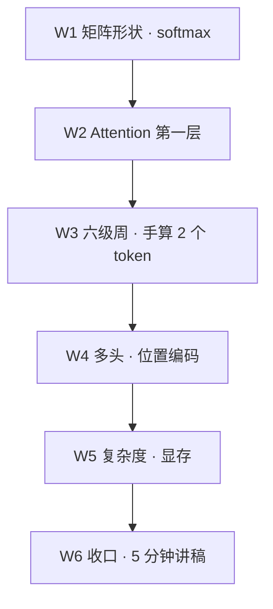

# 学习进度

> 六周通识轨：把 Attention 从「看不懂」变成「能讲五分钟」，寒假再进 CUDA 与 ScaleX-IO。
> 进度只记在这个文件里，README 只做索引。

**最近更新**：2026-11-26 ｜ **当前**：W1 已完成 ｜ **进度**：`███░░░░░░░░░░░░░░░` 1 / 6

---

## 总表

| 周次 | 日期 | 主题 | 交付物 | 状态 |
| :--- | :--- | :--- | :--- | :--- |
| W1 | 11.26 – 11.30 | 矩阵形状 · softmax | 能说出 (2×3)·(3×4) 为什么是 (2×4) | ✅ 完成 |
| W2 | 12.01 – 12.07 | Attention 第一层 | 300 字解释 + 三个公式的形状标注 | ⬜ 待开始 |
| W3 | 12.08 – 12.14 | 六级周 · 只维持 | 纸笔手算 2 个 token 的 attention | ⬜ |
| W4 | 12.15 – 12.21 | 多头 · 位置编码 | 2 分钟口述录音 | ⬜ |
| W5 | 12.22 – 12.28 | 复杂度 · 显存 | 表 1 复述 + 4096² 的显存账 | ⬜ |
| W6 | 12.29 – 01.04 | 收口 | 5 分钟讲稿 + 一页纸 | ⬜ |

## W1 · 矩阵乘法与 softmax

11.26 四 — 11.30 一 ｜ ✅ 完成

- [x] **看 3B1B《线性代数的本质》第 4 集：矩阵乘法**（20′）
  - 产出：合上书，能说出 (2×3) 乘 (3×4) 为什么得 (2×4)
- [x] **手算一次 softmax**：把 `z = [2, 1, 0]` 变成三个概率（30′）
  - 产出：纸上写出五步，拍照留存
- **验收**：不用查资料，向自己解释「为什么每行加起来是 1」。
- **笔记**：[softmax 到底用在哪](notes/2026-11-26-softmax.md)

## W2 · Attention 的第一层

12.1 二 — 12.7 一 ｜ ⬜ 待开始

- [ ] **3B1B《Attention in transformers》可视化**（40′）
  - 产出：只记「Q 和 K 在比什么」这一件事
- [ ] **论文只读 §3.2.1 + 图 2，抄下三个公式**（40′）
  - 产出：每个字母旁边标出它的形状（Q 是 n×d_k）
- [ ] **写 300 字：attention 到底在干什么**（40′）
  - 规则：不许用「注意力」三个字解释注意力
- **验收**：能说出 Q·K 的点积是在衡量「这个 token 有多需要那个 token」。

## W3 · 六级周 · 只维持

12.8 二 — 12.14 一 ｜ ⬜

- [ ] **纸笔手算 2 个 token、d=2 的 attention**（30′）
  - 产出：一张 2×2 的表 + 加权求和，全程计算器

本周只此一件。12.12 考完，周六晚上别碰学习。

## W4 · 多头与位置

12.15 二 — 12.21 一 ｜ ⬜

- [ ] **读 §3.2.2 结论：为什么要 8 个头**（30′）
  - 产出：两个理由，用自己的话说
- [ ] **读 §3.5.1 位置编码，只记结论**（30′）
  - 产出：口述 2 分钟录音，存在手机里
- **验收**：录音里没有「大概是」「好像是」。

## W5 · 复杂度与代价

12.22 二 — 12.28 一 ｜ ⬜

- [ ] **抄表 1：三种结构的复杂度与路径长度**（40′）
  - 产出：一张手写小表，三行三列
- [ ] **算一次：n=4096 时 score 矩阵多大**（40′）
  - 产出：4096²×2 字节 ≈ 32 MB/头/层，写在纸上
- **验收**：能解释「KB 级 IO 粒度」这个说法从哪来。

## W6 · 收口

12.29 二 — 1.4 一 ｜ ⬜

- [ ] **把 300 字改成 5 分钟讲稿**（1h）
  - 产出：录音一遍，自己听一遍
- [ ] **整理一页纸：形状表 + 三个公式 + 两个问题**（1h）
  - 产出：这一页纸是整个冬天的底稿
- **验收**：合上讲稿，还能把这一页纸画出来。

## 期末周 1.5 – 1.18

不排任务，只保留「每周一条笔记、一次 commit」。考完再动。

## 寒假 1.19 解锁

- Python 两周：变量、循环、函数、numpy 数组——从零开始，20 小时
- CUDA：装环境、vector add、matmul tiling 对比
- ScaleX-IO：clone、编译、画出 IO 请求路径图
- 然后才是第一个 PR，和一份「能跑」的汇报

## 每周复盘

周日晚三行：交付了什么 / 卡在哪 / 下周能挤出几小时。

| 周次 | 交付了什么 | 卡在哪 | 下周小时数 |
| :--- | :--- | :--- | :--- |
| W1 |  |  |  |

---

**怎么更新**：做完一项就把 `[ ]` 改成 `[x]`；周日改顶部「最近更新 / 当前 / 进度」三个值，并在复盘表加一行。
