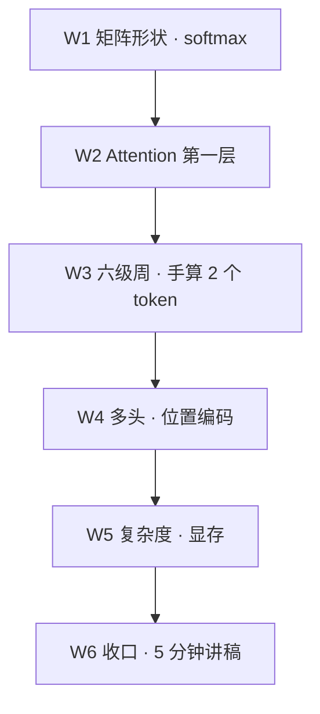

# AI Infra 学习日志

> 六周之内，把 Transformer 的 Attention 从「看不懂」变成「能讲五分钟」；寒假再进 CUDA 与 ScaleX-IO。

**最近更新**：2026-11-26 ｜ **当前**：W1 已完成 ｜ **进度**：`███░░░░░░░░░░░░░░` 1 / 6

---

## 这六周在做什么

六级（12.12）和期末（1 月中旬）压在前面，所以这六周**只做理论，不碰代码**。每周只安排一件事，做完就停；崩掉的一周只做 30 分钟。

## 六周计划

| 周次 | 日期 | 主题 | 产出 | 状态 |
| :--- | :--- | :--- | :--- | :--- |
| W1 | 11.26 – 11.30 | 矩阵形状 · softmax | 能说出 (2×3)·(3×4) 为什么是 (2×4) | ✅ 完成 |
| W2 | 12.01 – 12.07 | Attention 第一层 | 300 字解释 + 三个公式的形状标注 | ⬜ 待开始 |
| W3 | 12.08 – 12.14 | 六级周 · 只维持 | 纸笔手算 2 个 token 的 attention | ⬜ |
| W4 | 12.15 – 12.21 | 多头 · 位置编码 | 2 分钟口述录音 | ⬜ |
| W5 | 12.22 – 12.28 | 复杂度 · 显存 | 表 1 复述 + 4096² 的显存账 | ⬜ |
| W6 | 12.29 – 01.04 | 收口 | 5 分钟讲稿 + 一页纸 | ⬜ |



## 笔记

- [softmax 到底用在哪](notes/2026-11-26-softmax.md) — 2026-11-26，W1
- [Transformer 观看笔记](Transformer%20learning/transformer%20notes.md) — 3B1B 深度学习系列 1–5
- [我的疑问与解答](Transformer%20learning/questions.md)
- [CUDA 笔记](CUDA/CUDA%20notes.md)
- [OS 笔记](OS/OS-learning%20notes.md)

## 目录

```
Transformer learning/   3B1B 系列观看笔记（截图为主）
notes/                  2026-11 起的结构化笔记
CUDA/                   CUDA
OS/                     操作系统
```

## 三条规则

1. **先通识，再进代码。** 概念没通之前，写代码只是抄。
2. **每周日晚复盘三行**：交付了什么 / 卡在哪 / 下周能挤出几小时。
3. **崩掉的一周只做 30 分钟**：一条笔记 + 一次 commit，就算没断。
